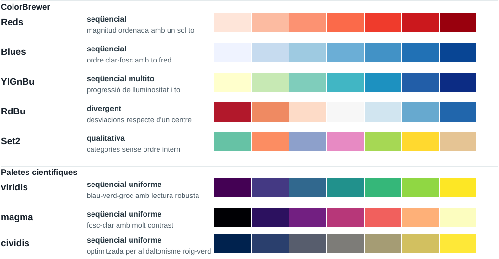

```{python}
from html import escape
from pathlib import Path


def find_project_root(start):
    path = Path(start).resolve()
    for candidate in (path, *path.parents):
        if (candidate / ".unaltraweb" / "computations.yml").is_file():
            return candidate
    raise RuntimeError("Project root not found: missing .unaltraweb/computations.yml")


root = find_project_root(Path.cwd())
output = root / "assets/img/color-cartography/palette-reference-swatches.svg"
output.parent.mkdir(parents=True, exist_ok=True)

rows = [
    {
        "family": "ColorBrewer",
        "name": "Reds",
        "kind": "seqüencial",
        "use": "magnitud ordenada amb un sol to",
        "colors": ["#fee5d9", "#fcbba1", "#fc9272", "#fb6a4a", "#ef3b2c", "#cb181d", "#99000d"],
    },
    {
        "family": "ColorBrewer",
        "name": "Blues",
        "kind": "seqüencial",
        "use": "ordre clar-fosc amb to fred",
        "colors": ["#eff3ff", "#c6dbef", "#9ecae1", "#6baed6", "#4292c6", "#2171b5", "#084594"],
    },
    {
        "family": "ColorBrewer",
        "name": "YlGnBu",
        "kind": "seqüencial multito",
        "use": "progressió de lluminositat i to",
        "colors": ["#ffffcc", "#c7e9b4", "#7fcdbb", "#41b6c4", "#1d91c0", "#225ea8", "#0c2c84"],
    },
    {
        "family": "ColorBrewer",
        "name": "RdBu",
        "kind": "divergent",
        "use": "desviacions respecte d'un centre",
        "colors": ["#b2182b", "#ef8a62", "#fddbc7", "#f7f7f7", "#d1e5f0", "#67a9cf", "#2166ac"],
    },
    {
        "family": "ColorBrewer",
        "name": "Set2",
        "kind": "qualitativa",
        "use": "categories sense ordre intern",
        "colors": ["#66c2a5", "#fc8d62", "#8da0cb", "#e78ac3", "#a6d854", "#ffd92f", "#e5c494"],
    },
    {
        "family": "Paletes científiques",
        "name": "viridis",
        "kind": "seqüencial uniforme",
        "use": "blau-verd-groc amb lectura robusta",
        "colors": ["#440154", "#443983", "#31688e", "#21918c", "#35b779", "#90d743", "#fde725"],
    },
    {
        "family": "Paletes científiques",
        "name": "magma",
        "kind": "seqüencial uniforme",
        "use": "fosc-clar amb molt contrast",
        "colors": ["#000004", "#2c115f", "#721f81", "#b73779", "#f1605d", "#feb078", "#fcfdbf"],
    },
    {
        "family": "Paletes científiques",
        "name": "cividis",
        "kind": "seqüencial uniforme",
        "use": "optimitzada per al daltonisme roig-verd",
        "colors": ["#00224e", "#2a3f6d", "#575d6d", "#7d7c78", "#a59c74", "#d2c060", "#fee838"],
    },
]

layout_width = 1180
viewport = (72, 118, 1036, 539)
left = 74
kind_x = 252
swatch_x = 516
swatch_width = 78
swatch_height = 42
row_positions = [144, 206, 268, 330, 392, 488, 550, 604]

svg = [
    f'<svg xmlns="http://www.w3.org/2000/svg" width="{viewport[2]}" height="{viewport[3]}" viewBox="{" ".join(map(str, viewport))}" role="img" aria-labelledby="title desc">',
    '  <title id="title">Mostres de paletes cartogràfiques i científiques</title>',
    '  <desc id="desc">Comparació de paletes ColorBrewer, amb exemples seqüencials, divergents i qualitatius, i de mapes de color perceptualment uniformes com viridis, magma i cividis.</desc>',
    '  <style>:root { background-color: #ffffff; }</style>',
    f'  <rect id="manual-opaque-background" x="{viewport[0] - 1}" y="{viewport[1] - 1}" width="{viewport[2] + 2}" height="{viewport[3] + 2}" fill="#ffffff"/>',
    "  <defs>",
    "    <style>",
    "      .rule { stroke: #d3dce0; stroke-width: 1.2; }",
    "      .section { font: 700 17px Arial, 'Liberation Sans', sans-serif; fill: #17202a; }",
    "      .name { font: 700 19px Arial, 'Liberation Sans', sans-serif; fill: #17202a; }",
    "      .kind { font: 700 16px Arial, 'Liberation Sans', sans-serif; fill: #263640; }",
    "      .use { font: 15px Arial, 'Liberation Sans', sans-serif; fill: #52616b; }",
    "      .swatch { stroke: #ffffff; stroke-width: 2; }",
    "    </style>",
    "  </defs>",
]

last_family = None
for row, y in zip(rows, row_positions, strict=True):
    if row["family"] != last_family:
        svg.append(f'  <line x1="{left}" y1="{y - 24}" x2="{layout_width - left}" y2="{y - 24}" class="rule"/>')
        svg.append(f'  <text x="{left}" y="{y - 6}" class="section">{escape(row["family"])}</text>')
        last_family = row["family"]

    svg.append(f'  <text x="{left}" y="{y + 26}" class="name">{escape(row["name"])}</text>')
    svg.append(f'  <text x="{kind_x}" y="{y + 19}" class="kind">{escape(row["kind"])}</text>')
    svg.append(f'  <text x="{kind_x}" y="{y + 42}" class="use">{escape(row["use"])}</text>')
    for i, color in enumerate(row["colors"]):
        x = swatch_x + i * swatch_width
        svg.append(f'  <rect x="{x}" y="{y}" width="{swatch_width}" height="{swatch_height}" class="swatch" fill="{color}"/>')

svg.append("</svg>")

output.write_text("\n".join(svg) + "\n", encoding="utf-8")
```


